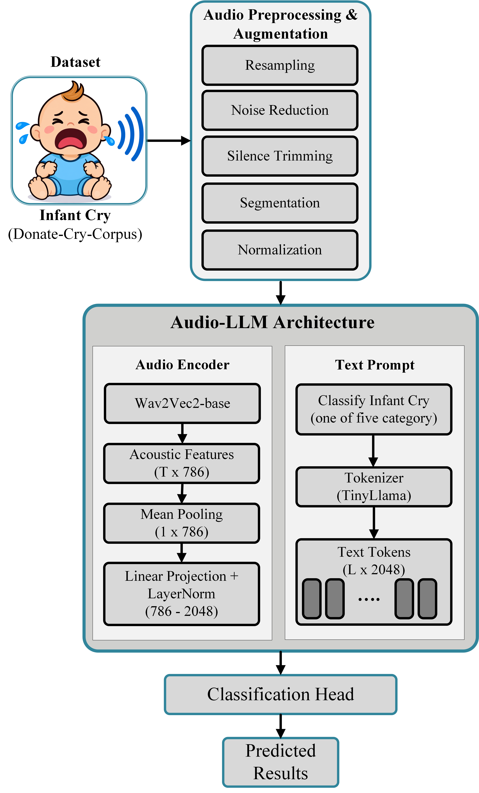

# A-Lightweight-Audio-LLM-Framework-for-Infant-Cry-Behavior-Recognition-Using-Wav2Vec2-and-TinyLlama

> This study proposed a Lightweight-Audio-LLM-Framework-for-Infant-Cry-Behavior-Recognition-Using-Wav2Vec2-and-TinyLlama

---

## 📌 Table of Contents
- [About](#Abstract)
- [Features](#Methodology)
- [License](#Authors)
- [Contact](#contact)

---

## 📖 Abstract

 We propose a lightweight Audio-Large Language Model (Audio-LLM) framework for infant cry behavior recognition by integrat-
ing a pre-trained Wav2Vec2-base audio encoder with the TinyLlama-1.1B language model. Wav2Vec2-base extracts
high-level acoustic representations directly from the infant cry waveform, which are temporally aggregated and trans-
formed through a linear projection and LayerNorm into an LLM-compatible audio token. The resulting audio 
representation is combined with a task-specific text prompt and processed by TinyLlama, while Low-Rank Adaptation
(LoRA) enables parameter-efficient adaptation of the language model. 
---

# Methodology

---
# Author
Muhammad Sheraz Khan

---

📬 Contact

GitHub: Department of Electronic Engineering, Kookmin Unversity, Seoul, South Korea

Email: msherazkhan313@gmail.com
